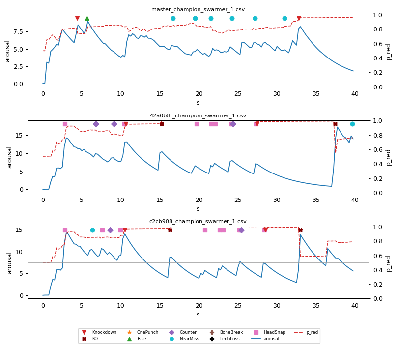

# 試合の面白さ（今の master、2026-11-19）

測り方は docs/EXCITEMENT.md。道具: `excitementleague --seeds 2 --seconds 40`（既定の 3 組）。

## 面白さ 02c8c68（各組 2 試合 × 40 秒、種 1〜、PhysicsVersion 59・LogicVersion 57）

| 組 | 総合 | 派手さ/分 | ドラマ | 驚き | はらはら | 最大の揺れ | 入れ替わり | 緩急 | 退屈 % | 最長の退屈 s | 山/分 | 空白 % | 生ダメージ | Exchange | NearMiss | Graze | Counter | Flurry | Knockdown | Rise | KO | OnePunch | BoneBreak | LimbLoss | VoxelLoss | Shatter | HeadSnap |
|---|---|---|---|---|---|---|---|---|---|---|---|---|---|---|---|---|---|---|---|---|---|---|---|---|---|---|---|
| champion:swarmer | 136.4 | 66.7 | 74.8 | 1.99 | 0.032 | 0.35 | 1 | 28.3 | 2 | 0.8 | 6.0 | 41 | 208 | 11 | 8 | 1 | 1 | 7 | 4 | 2 | 1 | 0 | 0 | 0 | 0 | 0 | 2 |
| slugger:outboxer | 164.1 | 94.9 | 88.2 | 1.90 | 0.036 | 0.38 | 4 | 28.4 | 4 | 1.8 | 5.3 | 12 | 194 | 10 | 13 | 1 | 7 | 5 | 5 | 3 | 1 | 1 | 0 | 0 | 0 | 0 | 3 |
| counter:jabber | 91.5 | 81.6 | 29.2 | 0.65 | 0.005 | 0.46 | 0 | 21.5 | 3 | 1.5 | 4.5 | 22 | 107 | 8 | 8 | 1 | 3 | 4 | 8 | 6 | 2 | 0 | 0 | 0 | 0 | 0 | 2 |
| **全体** | 130.7 | 81.1 | 64.1 | 1.51 | 0.024 | 0.40 | 5 | 26.1 | 3 | 1.8 | 5.3 | 25 | 170 | 29 | 29 | 3 | 11 | 16 | 17 | 11 | 4 | 1 | 0 | 0 | 0 | 0 | 7 |

出来事の数・入れ替わりは全試合の合計、最長の退屈は最大、ほかは 1 試合あたりの平均。
## 前の世代（42a0b8f）との比べ

| 世代 | 日付 | Physics | Logic | 総合 | 派手さ/分 | ドラマ | 驚き | 最大の揺れ | 入れ替わり | 緩急 | 退屈 % | 山/分 | 空白 % | 生ダメージ | 打ち合い | 紙一重 | 皮一枚 | カウンター | 連打 | ダウン | 立ち上がり | KO | 一撃 | 骨折 | 切断 | 欠け | 砕け | 首 | 動画 |
|---|---|---|---|---|---|---|---|---|---|---|---|---|---|---|---|---|---|---|---|---|---|---|---|---|---|---|---|---|---|
| 42a0b8f | 2026-11-18 | 46 | 51 | 209.6 | 181.1 | 84.9 | 2.07 | 0.50 | 6 | 34.2 | 2 | 7.0 | 18 | 586 | 28 | 31 | 7 | 13 | 24 | 15 | 10 | 4 | 2 | 0 | 0 | 0 | 0 | 56 | gen_42a0b8f_small.mp4 |
| 02c8c68 | 2026-11-19 | 59 | 57 | 130.7 | 81.1 | 64.1 | 1.51 | 0.40 | 5 | 26.1 | 3 | 5.3 | 25 | 170 | 29 | 29 | 3 | 11 | 16 | 17 | 11 | 4 | 1 | 0 | 0 | 0 | 0 | 7 | gen_02c8c68_small.mp4 |

全世代の表は `excitement_generations_2026-11-19.md`。

## 興奮の曲線と見込み p_red（champion 対 swarmer、種 1）

上から今の master（02c8c68）・42a0b8f・c2cb908。青い線が興奮（慣れのある曲線）、赤い破線が見込み p_red、印は出来事（▼ダウン・✖KO・◆カウンター・●紙一重・■首が持っていかれる）。

- 今の master: 4 秒で赤がダウン（打たれずに崩れた分も含む）しても p_red はほぼ動かない（ダウンの係数が小さい）。中盤は打ち合いの鎖で興奮が 5 前後に平らに続き、山が少ない。
- 42a0b8f: 首が持っていかれる強打（■）が 2〜4 秒ごとに来て、興奮が鋸の歯のように上下する（山が多い）。15 秒と 37 秒の KO で興奮と見込みが大きく動く。
- c2cb908: 強打（■）と倒し合いが続き、33 秒の KO で見込みが 1.0 から 0.6 へ戻る（逆転の揺れ。特別な規則なしに驚きとして出る）。

## 見込みのモデルの当てはまり

`excitementfit`（6 組 × 種 8 × 40 秒、赤青の鏡つき。勝ち負けの決め方と特徴の rounds・damageShare が重なるので、終盤の数字は甘い）: 使っていない種（奇数番）で Brier 0.127（五分の予想 0.25）、対数損失 0.38、正解率 80 %、試合の最後の 1/4 で 92 %。係数と記録は `winmodel_2026-11-19.json`。
係数の大きい順: 与えたダメージの割合の差（3.5、終盤 +3.2）・取ったラウンドの差（2.8、終盤 +2.0）・スタミナの差（−1.0: 打ち疲れた側＝攻めている側）・意識の差（0.67）・いまのダウン（0.49）・見えている欠け（0.04、今の世代は削れが少なく効かない）。

## 目で確かめた（`docs/video/excite_check.mp4`、映像の秒は `excite_check.highlights.txt`）

`py -3 tools/sheet.py docs/video/excite_check.mp4 docs/video/excite_check.sheet.png --times 6.9,7.33,11.2,11.3,11.53,34.57,38.87,40.92,41.67,53.77,54.65,28.97`

| 映像の秒 | 検出 | コマで見えた物 | 判定 |
|---|---|---|---|
| 6.9 | Exchange（行き来 6 回） | 両者が近い間合いで打ち合っている | 正しい |
| 7.33 | NearMiss（赤がよけた） | 赤が頭を外し、青の拳がそばを通る | 正しい |
| 11.3 | HeadSnap（青、42 rad/s） | 青の頭が打たれて回る（青は「ブロックからカウンター／スリップ」の途中） | 正しい |
| 11.53 | Knockdown（青、直前の打撃 3.4 J） | 青が倒れている | 正しい |
| 34.57 | Knockdown（赤、直前の打撃 0 J） | 赤は立っているように見えるが、カウント 2 が出ている | 誤検出ではないがドラマでない（打たれずにカウントが入った。強さ 0.25 に下げた） |
| 38.87 | NearMiss（青がよけた） | 青がブロック・頭を外す | 正しい |
| 40.92 | NearMiss（青、ダッキング） | 青がダッキングで下へ | 正しい |
| 41.67 | Knockdown（青、3.4 J） | 青が倒れている | 正しい |
| 53.77 | Flurry（赤） | 赤が倒れかけの青を続けて打つ | 正しい |
| 54.65 | Knockdown（青） | 青がマットに沈む | 正しい |

直した誤検出: (1) 当たった拳が紙一重として出ていた（11.3 秒: 当たりの処理より先に拳の飛行の終わりを見ていた）。(2) 肘で受けた当たりがカウンター・連打に数えられていた（ガード・肘・肩をクリーンヒットから外した）。
