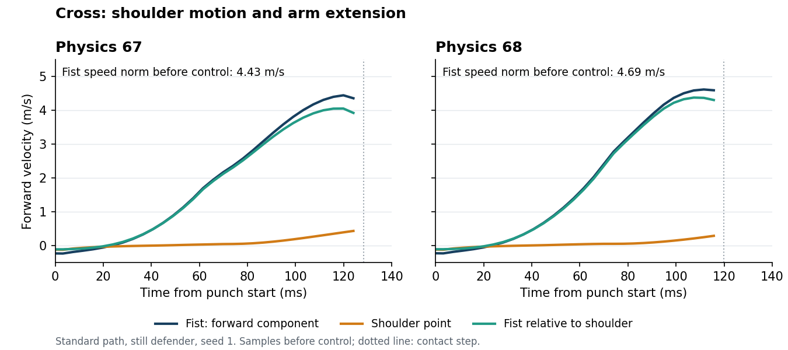

# 拳の速さと有効質量 — PhysicsVersion 68 の測定報告

2026-11-20、`claude/physics-consolidate-df71d8`。コミットなし。

## 結論と完了条件

**9 m/s・3 kg・120 J の目標は未達。統合可の判定はしていない。** 原因分解後、肩・肘を二重に制限していた速度上限を一つだけ修正した。届く右ストレートは4.43→4.69 m/s、6.34→5.73 kg、63.59→63.68 J、運動量28.40→27.02 kg·m/s。物理の保存則から9 m/sが自然に出た、という結果ではない。

**全テストでは新規失敗6件があり、現状のままの統合は推奨しない。** 速い段の新規失敗0件だけでは判断できない。ジャブ／フックの命中低下と、刀の試合の割当メモリ増加も確認した。

速さだけを合わせる倍率・筋力の水増し・種類分岐・姿勢の直接書き込みは加えていない。材料・ボットの判断・技の入力は変更していない。PhysicsVersion 67→68、LogicVersion 59のまま。

- [x] 指示書、CLAUDE.md §1、REAL_SCALE_PLAN.md §7・§9、関係するDEBTを確認。
- [x] 変更前の速いテストとpunchlabを保存。
- [x] 肩の並進・回転と肩に対する拳の速度、腕・胴の質量を時系列で分解。
- [x] 候補を一つずつ比較し、回帰テストのRED→GREEN、別エージェントのコードレビューを実施。
- [x] 種1〜3／4〜6、ジャブ・フック、40秒動画の前後比較と目視。
- [x] 同じRelease条件で全テストを比較し、新規失敗と未確定化を列挙。
- [x] 全14スタイルのleagueの同じRelease条件での前後集計を記録。
- [ ] 目標の速さ・質量・エネルギーを達成。

## 原因の分解

`FistScaleProbe.DecomposeCross` はpunchlabと同じ`Bout`・標準経路・間合い1.05腕・守らない相手・教科書の既定の溜めを使う。物理の変更前に採取した生の時系列と反事実は [fist-decompose-before.md](../arena/fist-decompose-before.md)。

肩の点速度は `v_chest + ω_chest × (shoulder − chest)`。拳はその点速度と「拳−肩」の相対速度に分解する。各速度列はその時点の顔の前方への射影で、拳の速さの大きさと区別する。時刻tの状態を保存してから次の歩を進め、その歩で発生したHITに対応させた。「接触直前」は接触する歩の制御前の観測で、制御の力積を加えた後の衝突キャッシュから得る`HitEvent.Speed`とは量だけでなく時点も異なる。接触後の減速を接触前の速度として使わない。

| 接触直前の量（種1） | 67 | 68 |
|---|---:|---:|
| 拳の速度の大きさ [m/s] | 4.4342 | 4.6880 |
| 拳の前方成分 [m/s] | 4.3542 | 4.5904 |
| 肩の前方成分 [m/s] | 0.4331 | 0.2883 |
| 肩に対する拳の前方成分 [m/s] | 3.9212 | 4.3022 |
| 胸の並進の前方成分 [m/s] | 0.0725 | 0.0166 |
| 胸の鉛直軸まわりの角速度 [rad/s] | 2.0484 | 1.6111 |
| 体から先走りへ渡した累積エネルギー [J] | 0.1536 | 0.1107 |
| 腕の質量として加えた量 [kg] | 3.3000 | 3.3000 |
| 実ヒットの胴の質量 [kg] | 3.0430 | 2.4326 |

67で肩の前進のうち約0.36 m/sは胸の回転による分。肩が動いても拳の目標は顔の向きの座標で保たれ、肩の速度を拳へそのまま足す構成ではない。Hillの式は肩に対する速度を使い、動く肩は筋の縮む速さの評価にも効く。胴の動きが完全に無効なのではなく、付け根の移動、関節の拘束、反作用、体を借りる力の上限、BodyCarryを通っている。

実測の接触前だけを図示。線は前方への射影、各図の注記は拳の速度ノルム。元の時系列から作成し、画像を実際に確認した。[SVG](../arena/fist-velocity-decomposition.svg)。

`TransferBodyMotion` は体幹の運動エネルギーを減らし、効率0.5の分を**目標の先走り**へ渡す。拳への直接の力積ではなく、その先走りを腕の筋が追う。直前の移送は約0.15 Jで、目標120 Jへの不足をこれだけで埋める大きさではない。単に効率を上げても、脚→骨盤→胸→肩→拳の運動量の鎖が成立したことにはならない。

有効質量6.343 kgの内訳は、上腕2.0＋前腕1.3＝3.3 kgを全量加算し、胴から3.043 kg。実ヒットでは、体の有効質量×腕の連結度に `LimbDrive × BodyCarry` を掛けている。時系列の`bodyMassUpperBound`は、この掛け算をする前の姿勢上の上限。HIT行の`body`が実際の分解値で、両者は混同しない。腕全体が拳と同じ速度で動く扱いは残っており、Walilkoの実験の有効質量を剛体の部位質量の和と同一視して3 kgに切る修正は採っていない。

## 一つずつ試した候補（変更前の体、種1）

| 条件 | 拳 [m/s] | 質量 [kg] | エネルギー [J] | 運動量 [kg·m/s] |
|---|---:|---:|---:|---:|
| 基準67 | 4.434 | 6.343 | 63.594 | 28.404 |
| 拳の先走りだけ0、体幹の消費は残る | 4.531 | 6.550 | 69.127 | 30.093 |
| ArmServoHzを半分 | 4.017 | 6.360 | 53.225 | 26.019 |
| 旧共通サーボ上限23.83→39.9 rad/s | 4.688 | 5.733 | 63.678 | 27.020 |
| MaxHandForce 350→500 N | 4.264 | 6.232 | 57.744 | 26.828 |
| 移送の時定数を1e6秒（抽出ほぼ0） | 4.508 | 6.747 | 70.307 | 30.802 |
| 肘・肩の筋の最大角速度を2倍 | 4.822 | 5.507 | 68.778 | 27.523 |

これらは調査用の反事実で、基準以外の値を既定の体へ入れたものではない。筋力を上げても速くならず、筋の最高速度だけを2倍にしても9 m/sに届かない。ArmServoHz=0の試行は生成後の落ち着き待ちで非有限値になって中止した。これは製品の回帰として数えず、正の周波数を使う半分のHzの比較へ直した。

肩の水平内転・肘の伸展を個別の解剖学的筋として実装したわけではない。現行は6方向の筋群と拳に掛ける最大力350 Nで、関節サーボは別に肩40／肘30 N·m。筋の最大角速度39.9 rad/sは既存の線維長・てこの推定を維持した。肩の測定トルク60〜100 N·mを、そのまま拳の力やサーボへ追加して二重に駆動する変更はしていない。

限定修正後68でも制御側の律速を追加確認した（種1、同じ標準ストレート）。既存の`MaxTargetSpeed`は10.07 m/sで、脚の目標にも共通の設定なので拳だけの上限とは扱わない。

| 68の反事実 | 拳 [m/s] | 質量 [kg] | エネルギー [J] | 運動量 [kg·m/s] |
|---|---:|---:|---:|---:|
| 基準68 | 4.688 | 5.733 | 63.678 | 27.020 |
| 目標速度の上限を既存NoCapSpeedへ | 4.688 | 5.733 | 63.678 | 27.020 |
| 目標速度の平滑化を1歩で完了 | 4.711 | 5.906 | 65.706 | 27.858 |
| 肘・肩の筋の最大角速度を2倍（サーボも追従） | 5.482 | 5.560 | 87.642 | 31.219 |

この条件では目標速度の上限は律速しておらず、平滑化を外しても9 m/sには届かない。68では筋の速度とサーボ上限が連動するため、2倍の反事実は67の2倍試行より上がるが、なお目標速度・質量は未達で運動量も増える。既存の39.9 rad/sを2倍へ替える身体的根拠は得られていないため採らない。生のProbe出力は [fist-target-control.md](../arena/fist-target-control.md)。これらを製品の調整値へ反映していない。

## 実装した限定修正

- `Fighter.Arm.Create`: 肩サーボは`ShoulderMuscleMaxSpeed`、肘は`ElbowMuscleMaxSpeed`を使う。
- `Arm.AddElbowServo`: 再接続した肘も同じ速度尺度を使う。
- 手首・骨片の固定で使う既存の`ArmServoMaxSpeed=23.83`は維持。そこへ肩や肘の速度変更を波及させない。
- `StickReviewSettings`: 腕の速度警報の尺度も筋の値へ合わせた。既存の単一尺度には肩・肘の大きい方を使うので、遅い方の関節には保守的。
- `PunchLab.Bout`に測定用の任意のtuningを渡せるようにした。省略時は従来と同じ体。試合に調査用の条件を選ぶ分岐は追加していない。

設計判断: 新しい速度調整値を増やさず、肩・肘の既存の筋の値を共有する。全用途の`ArmServoMaxSpeed`を筋の最小値へ一括変更する案は、レビューで手首・骨片まで結合すると分かったため採らなかった。Hillの力の計算そのものと部位の質量は変更していない。

## 指定のpunchlabの前後と未使用の種

`--paths standard --defenders still`、狙いあご、溜め0.1343秒、既定の届く／半歩遠い間合い。種ごとに新しい試合。67の種1〜6は同値で、68も種1〜3と4〜6で同値。これは入力の揺れのないドリルでの確認で、種の影響がある試合の一般化まで証明するものではない。

| 届く間合い | 67、種1〜6 | 68、種1〜3 | 68、種4〜6 | 目標 |
|---|---:|---:|---:|---:|
| 当たる拳 [m/s] | 4.43 | 4.69 | 4.69 | 約9（7〜11） |
| 当たる相対速度 [m/s] | 4.48 | 4.71 | 4.71 | — |
| 有効質量 [kg] | 6.34 | 5.73 | 5.73 | 約3（1〜5） |
| エネルギー [J] | 63.59 | 63.68 | 63.68 | 約120（60〜200） |
| 運動量 [kg·m/s] | 28.40 | 27.02 | 27.02 | 約27 |
| 接触まで [s] | 0.128 | 0.120 | 0.120 | — |
| 当たり | 6/6 | 3/3 | 3/3 | — |

半歩遠い間合いは拳3.56→3.28 m/s、質量9.77→10.22 kg、エネルギー57.78→51.15 J。遠い間合いも一律に改善したわけではない。どちらも胸への接触で、あごを狙って頭に当たった測定ではない。

生記録: [変更前](../arena/fist-before.md)、[変更後・種1〜3](../arena/fist-after-seeds123.md)、[変更後・種4〜6](../arena/fist-after-seeds456.md)。

## ジャブ・フック

`attacklab --combos 1,2,3 --telegraphs 0.08 --ranges 1.05 --bouts 4 --seconds 12`、既定種1。連続して打つボットのドリルなので、姿勢・間合い・相手の動きが変わった後の平均を含む。`HitEvent.Speed`（対象との相対接近速度）に加え、接触する歩の制御前の拳の速度ノルムを記録するよう計測を拡張した。最終比較は前後とも同じ拡張版の計測コードをReleaseでビルドした。初回の変更前Debug物理＋拡張計測器での測定とも全列一致した。

| 単発の技 | 当たり/打った本数 67→68 | 拳の速度ノルム [m/s] 67→68 | 相対接近速度 [m/s] 67→68 | 有効質量 [kg] 67→68 | エネルギー [J] 67→68 |
|---|---|---|---|---|---|
| 1 ジャブ | 8/9→2/8 | 2.46→3.21 | 2.68→3.41 | 3.30→3.30 | 12.58→19.17 |
| 2 ストレート | 4/9→5/12 | 4.06→3.04 | 4.23→3.01 | 3.30→3.31 | 29.46→15.70 |
| 3 左フック | 8/11→4/11 | 4.52→4.02 | 4.69→4.20 | 3.82→3.91 | 41.42→32.81 |

**ジャブ／フックが壊れていないとまでは言えない。** ジャブは速くなったが当たりが減り、フックは拳速・当たりとも下がった。制御前の標本時点と連続ドリル平均という測定条件の違いはあるが、人の拳の目安であるジャブ6〜7、フック7〜9 m/sにも届いていない。ストレートだけの表で採否を決めない。最終の拡張計測の生記録は [前・Release](../arena/fist-attack-absolute-before-release.md)・[後・Release](../arena/fist-attack-absolute-after.md)。初期の変更前Debugの [拡張計測](../arena/fist-attack-absolute-before.md) とも一致し、従来の相対速度だけの記録 [前](../arena/fist-attack-before.md)・[後](../arena/fist-attack-after.md) とも、当たり・相対速度・質量・エネルギーが一致した。

## 試合の前後比較

通常の`league --bouts 4 --seconds 60`（既定14スタイル、種1、364試合）と、ボクシング4スタイルに絞った24試合を別々に測った。各組の種は同じだが、対象リストの添字も種に使うため、24試合の表を364試合からの抜き出しとは扱わない。

ボクシング4スタイルは`champion,swarmer,counter,slugger`。奪ダウンの合計37→37、KO/ROで取ったラウンド9→10。この範囲ではダウンの総数は消失・急増していない。順位・勝敗は変わり、championは12勝0敗から9勝2分1敗。与ダメージ平均もsluggerの138→178のように一律でない。生記録は [前](../arena/fist-league-boxing-before.md)・[後](../arena/fist-league-boxing-after.md)。

全スタイルの通常リーグは前後ともReleaseで完了。奪ダウンは727→705（約3%減）、KO/ROで取ったラウンドは144→139（約3.5%減）。この集計でダウンが消失・急増したとは言えない。上位はchampion-v1・championのままだが、勝敗とスタイルごとのダメージは変わる。生記録は [前・Release](../arena/fist-league-before-release.md)・[後・Release](../arena/fist-league-after.md)。初回の [変更前Debug](../arena/fist-league-before.md) と変更前Releaseはファイル全体が一致した。通常リーグの奪ダウンは`IsKnockedDown`がfalse→trueになった回数で、審判が取らない中腰・転倒を含めない。

| 通常リーグ・全14スタイル | 67 | 68 |
|---|---:|---:|
| 試合 | 364 | 364 |
| 奪ダウン合計 | 727 | 705 |
| KO/ROで取ったラウンド | 144 | 139 |

既存の通常リーグの出力表は、接触イベントの総数や単純な転倒・削れ・骨折を列として保存しない。その全364試合の全数比較は未取得。次の24試合の補助測定と動画・回帰試験を、その代わりの全数集計とは扱わない。

転倒と当たりは既存の`staminalab --variants on --bots champion,swarmer,counter,slugger --bouts 4 --seconds 60 --seed 1`で補助測定。`on`は既定物理だがペース配分の入力を0に固定するため、通常leagueと別の24試合である。ここの「ダウン」は審判のダウンではなく、立位から別の`FighterState`へ移る回数。当たりも同じ拳の接触をまとめず`RecentHits`のイベントを数える。前後とも同じ定義・入力で比較する。

| 補助測定（両者合計、1試合平均） | 67 | 68 |
|---|---:|---:|
| 倒れた回数 | 1.75 | 1.54 |
| 当たり・序盤 | 32.9 | 37.5 |
| 当たり・中盤 | 40.7 | 41.2 |
| 当たり・終盤 | 41.8 | 38.0 |
| 打った数・序盤/中盤/終盤 | 30.6 / 34.8 / 34.7 | 34.2 / 34.5 / 31.8 |

この24試合では転倒は少し減り、当たりは序盤に増えて終盤に減った。接触イベント総数の1試合平均は、丸め済みの区間の和で115.4→116.7。命中した拳の本数より接触イベントが多くなる定義なので、技の命中率には換算しない。最終比較は前後ともRelease。生記録は [前・Release](../arena/fist-falls-before-release.md)・[後・Release](../arena/fist-falls-after.md)。初期の [変更前Debug](../arena/fist-falls-before.md) とも表の全列一致した。

## テスト・レビュー

- ECC `tdd-workflow`で新規回帰テストを先に実行。手首・固定用の速度を変えると肩・肘の拳の動きも変わることをREDで確認し、限定修正後にGREEN。肩だけ／肘だけの筋の速度を下げると実際の拳の動きが変わる対照も実行。
- 棒人形の速度警報が旧上限を使う問題も、期待55 rad/sに対して4 rad/sとなるREDを確認して修正。新規テスト2件は合格。
- attacklabに拳自身の速度を残す診断も、`Result.FistSpeed`が無いコンパイル失敗をREDとして確認し、計測追加後のProbe 1件が合格。これは通常の回帰2件と別の調査テスト。
- 速い段は前後とも **622件、615合格・7失敗**。失敗名の集合の差は空で、新しく落ちた速いテストは0。ブリーフの「masterの30件」を速い段の実測値として転記していない。
- 既存テストと期待値は変更・緩和していない。新規物理テストはslow、調査クラスはProbeに分類。
- 別エージェントに測定コード、製品コード、回帰テスト、速度警報をレビューさせ、指摘をすべて反映。
- 全テストは同じRelease条件で、変更前1283件・1248合格・30失敗・5スキップ、変更後1285件・1248合格・31失敗・6スキップ。初回の変更前全テストはDebugだったため中断し、HEADのFighter/StickReviewを取り出して製品・参照先・テストを隔離再ビルド。同じrunsettings（3クラス並列）で再測定した。版の定数が混ざらないようテストも再コンパイルし、変更前には存在しなかったArmSpeedLimitTestsの2件だけ追加で除外。調査用Probeとvisualは前後とも除外。速い段の初期比較はDebug-before/Release-afterであり、最終の失敗差分は同じRelease条件の全テストを使う。ブリーフの30件は全テストの変更前の実測と一致した。
- ECC `tdd-guide`の別エージェントで失敗を切り分け、割当と共有集計を1メソッドずつ同じReleaseで追加確認。`KatanaMatch_AllocatesLittlePerStep`は変更前が合格、変更後は中央値109,512 byte/歩（上限70,000）で失敗を再現。全テストでの109,544 byte/歩も、他プロセスのCPU負荷だけでは説明できない。性能回帰として残し、上限を緩めない。一方`DrillMeter_CountsPunchAndBaseline`は単独では前後とも合格したが、全テストでは前後共通の失敗。変更後は6.713999999999999と6.714の厳密比較で失敗した。共有集計と丸め・隔離の影響が疑われるが、全テストの失敗から除外しない。
- tower32への実行は自動承認審査で内部コードの外部送信の明示的な承認が確認できないとして拒否されたため、迂回せずローカルへ切り替えた。

新しく落ちた既存テストは次の6件（すべてslow）。通常のテスト・期待値は一切緩めていない。

1. `BootSnagTests.WalkingDiagonallyOnTheCanvas_NeverStallsAndFinishesTheCourse`
2. `ClubSwingTests.AClubBlow_CrushesMoreOfTheBody_ThanAPunchCarvesAtMost`
3. `KneeControlTests.Roundhouse_AtItsStandoff_LandsWithTheLowerShinOrAnkle_AcrossSeedsAndBothLegs`
4. `StepCostRegressionTests.KatanaMatch_AllocatesLittlePerStep`
5. `TonfaTests.ASwordSweepingAtTheGuard_MeetsTheWoodOfTheStick_BeforeTheFleshOfTheForearm`
6. `WeaponGraspTests.ReleasingTheSecondHand_LeavesAOneHandedHold_AndGrippingNearTheHandleJoinsAgain`

新規6件は対象を絞った再実行でも、変更前6件合格／変更後6件失敗を再現した（割当は1メソッド単独、残る5件は5件だけのフィルター）。失敗の中身を広く言い換えない。

| 対象 | 変更後の失敗した性質 |
|---|---|
| BootSnag | 円経路・種1の停止時間1.8708秒が上限1.678秒を超過。コース未完の主張ではない。 |
| ClubSwing | 命中したが損傷37セルで下限42セルに届かない。補充前のスタミナも約99.95%で、疲弊では説明できない。 |
| KneeControl | 種2・左脚の303 Jの命中後にGettingUp。未命中ではなく転倒。後続の種はassertで未評価。 |
| Tonfa | 木も27セル削れるが、前腕損傷2セルがグローブ条件0セルより増える。木への接触自体はある。 |
| WeaponGrasp | 手離し・片手保持は通り、最後の左手による再把持がnull。 |
| StepCost | 刀の試合の1歩の割当中央値が上限70 KBを超過。 |

材料は変えていないので、ClubSwingやTonfaの損傷の差は材質変更によるものとは説明しない。再実行の集計とassertの生のメッセージは [fist-tests-isolation.md](../arena/fist-tests-isolation.md)。

変更前の失敗のうち、BojutsuのGaeshi、CmaTuneのCounterDamage、PredictionのInsideSlip、Swordの狙う部位は今回は合格へ変わった（4件）。一方、`KickContactTests.TurningKicks_TurnTheBody_AndLandWithTheFootPartTheirPathPoints`は失敗から`NotExecuted`へ変わったので改善とは数えない。残る25件は前後共通の失敗。DataRowの表示名も含めた全比較は [fist-tests-comparison.md](../arena/fist-tests-comparison.md)。TRXのCounters.notExecutedは0だったが、各UnitTestResultのNotExecutedが5／6件あったため、後者とコンソール集計でスキップを確認した。

速い段で既存の失敗は次の7件（前後共通）:

1. `ABracedNeck_HoldsMoreOfTheGloveBlowThatBentItClosest_ThanASlackOne`
2. `AFaintedNeck_IsWeakerThanABracedOne`
3. `OnlyOneSidesMuscle_Holds_AndTheSideFlipsWithThePush`
4. `SameBlow_KnucklesConcentrateDamageComparedWithPalm_AndHurtTheirOwnSkin (13.43)`
5. `ANeckWithItsMuscleCarvedAway_IsWeaker`
6. `MuscleInTheForearm_HoldsSomeOfTheBending_LikeTheNeck`
7. `AStepForward_CoversMoreGroundThanWalking_AndPeaksFaster`

既存objのアクセス拒否を避けて`--artifacts-path .fist-artifacts`を使用。既定のDebug DLLで実行中のleagueとのコピー競合は、測定用実行フォルダーとReleaseビルドへ分けて解消。最終のビルドは警告0・エラー0。ECCのコミット手順より、指示書の「コミットしない」を優先した。

隔離した変更前Releaseのpunchlab（種1、1/1命中）は、届く／半歩遠いとも初回の67の1本あたりの速度・質量・エネルギー等の平均と種1の時系列が一致した。[再現確認](../arena/fist-baseline-release-check.md)。全14スタイルのリーグもReleaseで前後比較済み。生のTRXはローカルの`.fist-artifacts/test-results/`に保存し、比較表には全失敗名・スキップ数・差分を残した。READMEの既存件数は最新の実測と一致しないが、統合時の件数更新はCLAUDE.mdが統合役の担当としているため、ここでは実測を本報告と比較表に残す。

## 動画の目視

`video --red champion --blue swarmer --seconds 40`、種1。`tools/sheet.py --count 12`を既存Python312の実体で実行（`py -3`は登録先を見つけられなかった）。前後ともコマ画像を実際に読んだ。

- 67: 開始後の打ち合い、青のダウン、起き直り、再び倒れ、KO。動画ログのKnockdownは2、Riseは1、KOは1。
- 68: ロープ際の近距離が長いが、拳を出す・戻す、かわす、相手へ返す姿が続く。動画のExchange記録には74発・行き来19回の区間があり、当たらないままクリンチしているだけではない。選んだ12コマとハイライトにダウンはなく、40秒打ち合ってダメージ判定。67と同じ倒れ方ではない。
- どちらの動画にもハイライトの骨折イベントはない。68には皮膚1セルのGraze記録がある。材料は変更せず、削れ・骨折がリーグ全体で維持されたかは別の集計が必要。

動画: `docs/video/fist-before.mp4`・`fist-after.mp4`。コマ: `fist-before.sheet.png`・`fist-after.sheet.png`。これらは既存のgitignoreの対象。ハイライトの生記録は追跡可能な [前](../arena/fist-video-before-highlights.txt)・[後](../arena/fist-video-after-highlights.txt) にも保存。

## 見送ったことと残る近道

1. **目標を9 m/sへ合わせる筋力・速度の倍率**: 単独試行で届かず、文献の筋の値との整合を失う。採らない。
2. **全用途の共通速度を一括変更**: 手首・固定まで巻き込む。肩・肘だけ修正した。
3. **腕の有効質量の付け替え**: 上腕・前腕の速度／慣性と関節のコンプライアンスから衝突の間の有効質量を導出する必要がある。腕を1.9 kgに置換、3 kgで頭打ち、余った質量を倍率で割る変更はしない。
4. **体幹からの直接の力積への変更**: 反作用とエネルギーを同時に保存し、関節の拘束がすでに渡す分を二重に数えない連成モデルが必要。現在の小さい先走りを直接加速へ置換するだけでは不足する。
5. **肩・肘サーボとHill筋の統合**: 速度尺度だけは共通化したが、40／30 N·mのサーボは依然としてHillの式の外にある。解剖学的筋群・神経の遅れ・足だけから地面の反力を得る構成も未実装。
6. **技の入力の変更・材料の校正**: 今回は触らない。あごを狙って胸に当たる条件、近距離・フックの命中低下、現実より強い骨、応力の相似の倍率は残る。

次に進めるなら、腕の全質量加算を先に小さな固定値へ替えるのではなく、足→骨盤→胸→肩の速度と筋の仕事、関節ごとの力・反作用・衝突時の慣性を一つの計算へ寄せる。今回の差分だけで段3の1を完了扱いにはしない。

## 参照・再利用の確認

- [Walilkoら2005・原著の要旨](https://pubmed.ncbi.nlm.nih.gov/16183766/): 手の速度9.14±2.06 m/s、有効質量2.9±2.0 kg。接触条件・計測法を含む有効質量であり、剛体の部位質量の和の規定ではない。
- [OpenSimのMuscle API](https://github.com/opensim-org/opensim-core/blob/main/OpenSim/Simulation/Model/Muscle.h)、[Millardの実装](https://github.com/opensim-org/opensim-core/blob/main/OpenSim/Actuators/Millard2012EquilibriumMuscle.cpp): 線維長と最大収縮速度で速度を正規化する既存モデルを確認。新しい筋モデルや別の速度の式は追加せず、既存のArmMuscleとBepuサーボを再利用した。
- GitHubの上肢モデルも調べたが、今回の「既存Bepuのサーボに別上限を重ねない」という限定修正へ新しいソルバーを導入する必要はなかった。Context7／Exaのツールはこのセッションでは利用できない。
